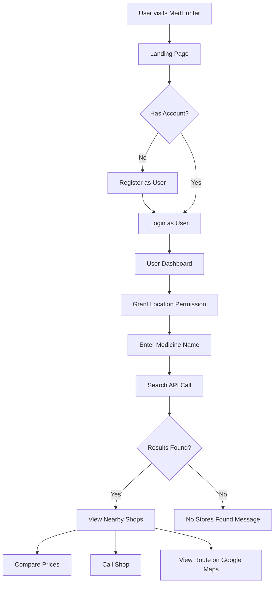
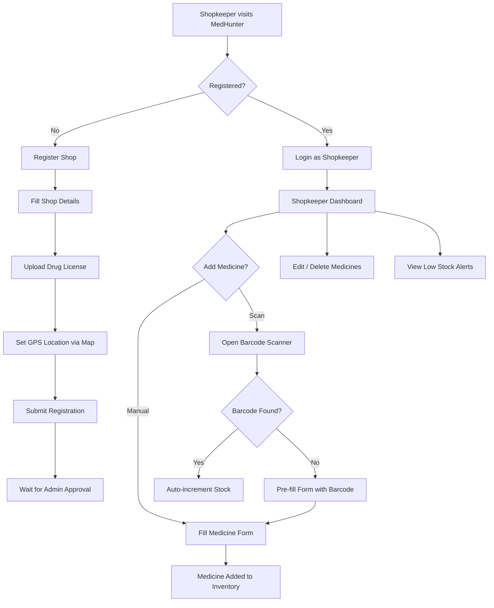
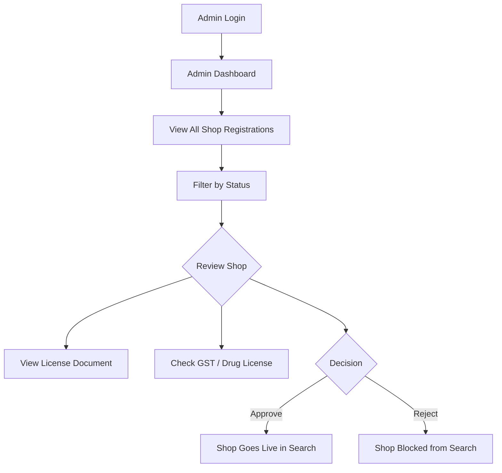
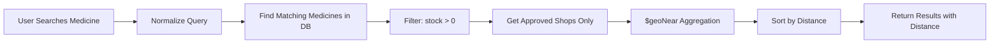

<p align="center">
  
</p>

<h1 align="center">💊 MedHunter 2.0</h1>

<p align="center">
  <strong>A location-aware medicine discovery platform connecting users, shopkeepers, and admins.</strong>
</p>

<p align="center">
  <a href="https://medhunt.centralindia.cloudapp.azure.com/">🌐 Live Demo</a> &nbsp;•&nbsp;
  <a href="#-features">✨ Features</a> &nbsp;•&nbsp;
  <a href="#%EF%B8%8F-tech-stack">🛠️ Tech Stack</a> &nbsp;•&nbsp;
  <a href="#-getting-started">🚀 Getting Started</a> &nbsp;•&nbsp;
  <a href="#-api-reference">📡 API Reference</a>
</p>

<p align="center">
  
  
  
  
  
  
  
  
</p>

---

## 📖 About

**MedHunter 2.0** is a full-stack web application designed to solve a real-world problem: finding specific medicines at nearby medical stores quickly and efficiently. Instead of physically visiting multiple pharmacies, users can search for a medicine by name and instantly discover which verified shops near them have it in stock — complete with pricing, distance, contact information, and Google Maps route directions.

The platform operates with **three distinct roles**, each with its own focused dashboard:

| Role | Purpose |
|------|---------|
| **👤 User** | Search medicines by name, discover nearby stores with stock, compare prices, call shops, and get route directions |
| **🏪 Shopkeeper** | Register a medical store, manage medicine inventory, scan barcodes to add stock quickly |
| **🔐 Admin** | Review shop registrations, verify drug licenses, approve or reject stores |

> **🔗 Live at:** [https://medhunt.centralindia.cloudapp.azure.com/](https://medhunt.centralindia.cloudapp.azure.com/)

---

## ✨ Features

### 👤 User Features
- 🔍 **Medicine Search** — Search by medicine name across all verified nearby stores
- 📍 **Geolocation-Based Results** — Uses browser Geolocation API to find stores within a configurable radius (default: 10 km)
- 💰 **Price Comparison** — Compare prices across multiple nearby stores
- 📞 **One-Tap Call** — Call the shop directly from the results
- 🗺️ **Route Directions** — Get Google Maps directions to the shop with a single click
- 📜 **Search History** — Recent searches are remembered for quick repeat lookups

### 🏪 Shopkeeper Features
- 📝 **Shop Registration** — Register with shop details, drug license, GST number, and location
- 🗺️ **Interactive Map** — Leaflet-powered map with live location preview during registration
- 📸 **License Upload** — Upload drug license photo (stored on Cloudinary)
- 💊 **Inventory Management** — Full CRUD for medicines (add, edit, delete)
- 📊 **Dashboard Stats** — Total medicines, low-stock alerts, shop ID at a glance
- 📷 **Barcode Scanner** — Scan medicine barcodes via camera or image upload using `html5-qrcode`
  - Auto-detects **QR Code, EAN-13, EAN-8, UPC-A, UPC-E, CODE-128, CODE-39** formats
  - Pre-fills medicine details when barcode is recognized
  - Automatically increments stock for already-listed medicines

### 🔐 Admin Features
- 📋 **Shop Review** — View all registered shops with full details (owner, license, GST, address)
- ✅ **Approve / Reject** — Approve or reject shops with a single click
- 🔍 **Status Filtering** — Filter shops by status: All, Pending, Approved, Rejected
- 📊 **Overview Stats** — Total shops, approved, pending, and rejected counts
- 📄 **License Verification** — View uploaded license documents directly

### 🔒 Security Features
- 🔑 **JWT Authentication** — Token-based auth with 30-day expiry
- 🔐 **Password Hashing** — Passwords hashed with `bcryptjs` (12 salt rounds)
- 🛡️ **Role-Based Access Control** — Middleware-enforced route protection (`user`, `shopowner`, `admin`)
- 🚫 **Protected Routes** — Frontend route guards prevent unauthorized access

---

## 🛠️ Tech Stack

### Frontend

| Technology | Version | Purpose |
|------------|---------|---------|
| [React](https://react.dev/) | 19.2.4 | UI library with hooks-based architecture |
| [Vite](https://vite.dev/) | 8.0.4 | Lightning-fast build tool and dev server |
| [Tailwind CSS](https://tailwindcss.com/) | 4.2.2 | Utility-first CSS framework (via `@tailwindcss/vite` plugin) |
| [React Router DOM](https://reactrouter.com/) | 7.14.0 | Client-side routing with protected routes |
| [Leaflet](https://leafletjs.com/) + [React Leaflet](https://react-leaflet.js.org/) | 1.9.4 / 5.0.0 | Interactive maps for shop location preview |
| [Framer Motion](https://motion.dev/) | 12.38.0 | Animations and transitions |
| [html5-qrcode](https://github.com/mebjas/html5-qrcode) | 2.3.8 | Barcode and QR code scanning (camera + image upload) |
| [React Icons](https://react-icons.github.io/react-icons/) | 5.6.0 | Icon library |
| [ESLint](https://eslint.org/) | 9.39.4 | Code linting with React Hooks and Refresh plugins |

### Backend

| Technology | Version | Purpose |
|------------|---------|---------|
| [Node.js](https://nodejs.org/) | — | JavaScript runtime |
| [Express](https://expressjs.com/) | 5.2.1 | Web framework for REST API |
| [MongoDB](https://www.mongodb.com/) + [Mongoose](https://mongoosejs.com/) | 9.4.1 | NoSQL database with ODM and geospatial indexing |
| [JSON Web Tokens](https://jwt.io/) | 9.0.3 | Stateless authentication |
| [bcryptjs](https://www.npmjs.com/package/bcryptjs) | 3.0.3 | Password hashing |
| [Cloudinary](https://cloudinary.com/) | 1.41.3 | Cloud-based image/file storage for license photos |
| [Multer](https://www.npmjs.com/package/multer) | 2.1.1 | Multipart form-data handling for file uploads |
| [multer-storage-cloudinary](https://www.npmjs.com/package/multer-storage-cloudinary) | 4.0.0 | Direct Multer-to-Cloudinary storage integration |
| [cors](https://www.npmjs.com/package/cors) | 2.8.6 | Cross-Origin Resource Sharing |
| [dotenv](https://www.npmjs.com/package/dotenv) | 17.4.2 | Environment variable management |

### Database & Geospatial

| Feature | Implementation |
|---------|----------------|
| **Database** | MongoDB Atlas (cloud-hosted) |
| **ODM** | Mongoose with schema validation |
| **Geospatial Index** | MongoDB `2dsphere` index on shop locations |
| **Geospatial Query** | `$geoNear` aggregation pipeline for distance-based search |
| **Text Search** | MongoDB text index on medicine `name` and `manufacturer` fields |
| **Normalized Search** | `nameNormalized` field with pre-save hook for case-insensitive matching |

### Deployment & Infrastructure

| Service | Purpose |
|---------|---------|
| [Microsoft Azure](https://azure.microsoft.com/) | Cloud VM hosting (Central India region) |
| Azure VM | Application server |
| Domain | `medhunt.centralindia.cloudapp.azure.com` |

---

## 🏗️ Architecture

```
┌─────────────────────────────────────────────────────────────┐
│                        CLIENT (Browser)                     │
│  ┌───────────────────────────────────────────────────────┐  │
│  │               React 19 + Vite 8 SPA                   │  │
│  │  ┌─────────┐ ┌─────────────┐ ┌──────────────────┐    │  │
│  │  │ Landing  │ │ Auth Pages  │ │ Role Dashboards  │    │  │
│  │  │  Page    │ │ (Login/Reg) │ │ (User/Shop/Admin)│    │  │
│  │  └─────────┘ └─────────────┘ └──────────────────┘    │  │
│  │                      │                                │  │
│  │  ┌───────────────────┴───────────────────────────┐    │  │
│  │  │           Services Layer (api.js)             │    │  │
│  │  │   GET | POST | PUT | DELETE | POST (FormData) │    │  │
│  │  └───────────────────┬───────────────────────────┘    │  │
│  │                      │ JWT Bearer Token               │  │
│  └──────────────────────┼────────────────────────────────┘  │
│                         │ /api/*                             │
├─────────────────────────┼───────────────────────────────────┤
│                    Vite Dev Proxy                            │
│              (proxies /api → localhost:8080)                 │
├─────────────────────────┼───────────────────────────────────┤
│                         ▼                                   │
│               EXPRESS SERVER (Port 8080)                     │
│  ┌───────────────────────────────────────────────────────┐  │
│  │                    Middleware                          │  │
│  │   CORS │ JSON Parser │ URL Encoded │ JWT Auth         │  │
│  └───────────────────────┬───────────────────────────────┘  │
│                          │                                   │
│  ┌───────────┬───────────┼───────────┬───────────────────┐  │
│  │ /api/auth │/api/search│/api/meds  │ /api/admin        │  │
│  │           │           │           │                   │  │
│  │ Register  │ GeoNear   │ CRUD      │ Shop Management   │  │
│  │ Login     │ Search    │ Inventory │ Approve/Reject    │  │
│  └─────┬─────┴─────┬─────┴─────┬─────┴─────┬─────────────┘  │
│        │           │           │           │                 │
│        ▼           ▼           ▼           ▼                 │
│  ┌───────────────────────────────────────────────────────┐  │
│  │                MongoDB (Mongoose ODM)                  │  │
│  │  ┌──────┐  ┌──────────┐  ┌──────┐                    │  │
│  │  │ User │  │ Medicine │  │ Shop │                    │  │
│  │  │      │  │          │  │ (2dsphere)                │  │
│  │  └──────┘  └──────────┘  └──────┘                    │  │
│  └───────────────────────────────────────────────────────┘  │
│                          │                                   │
│  ┌───────────────────────┴───────────────────────────────┐  │
│  │              Cloudinary (Image Storage)                │  │
│  │         License photos → medhunter_licenses/          │  │
│  └───────────────────────────────────────────────────────┘  │
└─────────────────────────────────────────────────────────────┘
```

---

## 📁 Project Structure

```
MEDHUNTER_2.0/
│
├── server.js                    # Express server entry point
├── package.json                 # Backend dependencies
│
├── config/
│   ├── db.js                    # MongoDB connection setup
│   └── cloudinary.js            # Cloudinary + Multer storage config
│
├── middleware/
│   └── auth.js                  # JWT protect + role-based authorize
│
├── models/
│   ├── User.js                  # User schema (email, password, role)
│   ├── Shop.js                  # Shop schema (location, license, status)
│   └── Medicine.js              # Medicine schema (name, price, stock, shop)
│
├── controllers/
│   ├── authController.js        # Register/Login (user, shop, admin)
│   ├── medicineController.js    # CRUD for medicine inventory
│   ├── searchController.js      # Geospatial medicine search
│   └── adminController.js       # Shop approval/rejection
│
├── routes/
│   ├── authRoutes.js            # POST /api/auth/*
│   ├── medicineRoutes.js        # CRUD /api/medicines/*
│   ├── searchRoutes.js          # GET  /api/search
│   └── adminRoutes.js           # GET/PUT /api/admin/*
│
├── frontend/                    # React SPA
│   ├── index.html               # HTML entry point
│   ├── vite.config.js           # Vite + Tailwind + proxy config
│   ├── package.json             # Frontend dependencies
│   │
│   └── src/
│       ├── main.jsx             # App bootstrap (BrowserRouter + AuthProvider)
│       ├── App.jsx              # Route definitions
│       ├── index.css            # Global styles + animations
│       ├── App.css              # Component-level styles
│       │
│       ├── context/
│       │   └── AuthContext.jsx  # Auth state management (login/logout/persist)
│       │
│       ├── services/
│       │   └── api.js           # HTTP client (GET, POST, PUT, DELETE, FormData)
│       │
│       ├── components/
│       │   ├── ProtectedRoute.jsx  # Route guard by role
│       │   └── BarcodeScanner.jsx  # Camera + image barcode scanner
│       │
│       ├── pages/
│       │   ├── Landing/
│       │   │   └── LandingPage.jsx       # Marketing landing page
│       │   │
│       │   ├── Auth/
│       │   │   ├── RoleSelect.jsx        # Role selection (User/Shop/Admin)
│       │   │   ├── UserLogin.jsx         # User login form
│       │   │   ├── UserRegister.jsx      # User registration form
│       │   │   ├── ShopkeeperLogin.jsx   # Shopkeeper login form
│       │   │   ├── ShopkeeperRegister.jsx # Shop registration (with map + upload)
│       │   │   └── AdminLogin.jsx        # Admin login form
│       │   │
│       │   ├── User/
│       │   │   └── UserDashboard.jsx     # Medicine search + results
│       │   │
│       │   ├── Shopkeeper/
│       │   │   └── ShopkeeperDashboard.jsx # Inventory management + scanner
│       │   │
│       │   └── Admin/
│       │       └── AdminDashboard.jsx    # Shop approvals + filtering
│       │
│       └── assets/
│           ├── hero.png                  # Landing page hero image
│           └── react.svg                 # React logo
│
└── bar_sc/                      # Standalone barcode scanner module (prototype)
    ├── server.js                # Express server for barcode scanning
    ├── package.json             # Module dependencies
    ├── models/
    │   ├── medicine.js          # Simple medicine schema (name, barcode, type)
    │   └── inventory.js         # Inventory schema (shopId, medicineId, qty)
    └── frontend/                # React CRA frontend for scanner prototype
        ├── package.json
        └── src/
            ├── App.js
            ├── Scanner.js       # Barcode scanner component
            └── Inventory.js     # Inventory viewer component
```

---

## 🔄 Application Workflow

### 1. User Flow



### 2. Shopkeeper Flow



### 3. Admin Flow



### 4. Medicine Search Engine Flow



---

## 📡 API Reference

### Authentication

| Method | Endpoint | Description | Auth |
|--------|----------|-------------|------|
| `POST` | `/api/auth/register/user` | Register a new user | ❌ |
| `POST` | `/api/auth/register/shop` | Register a new shop (multipart) | ❌ |
| `POST` | `/api/auth/login/user` | Login as user | ❌ |
| `POST` | `/api/auth/login/shop` | Login as shopkeeper | ❌ |
| `POST` | `/api/auth/login/admin` | Login as admin | ❌ |

### Medicine Inventory (Shopkeeper Only)

| Method | Endpoint | Description | Auth |
|--------|----------|-------------|------|
| `POST` | `/api/medicines` | Add a new medicine | 🔒 shopowner |
| `GET` | `/api/medicines/my` | Get all medicines for logged-in shop | 🔒 shopowner |
| `PUT` | `/api/medicines/:id` | Update a medicine | 🔒 shopowner |
| `DELETE` | `/api/medicines/:id` | Delete a medicine | 🔒 shopowner |

### Search (User & Admin)

| Method | Endpoint | Description | Auth |
|--------|----------|-------------|------|
| `GET` | `/api/search?name=...&lat=...&lng=...&maxDistance=...` | Search medicines near a location | 🔒 user, admin |

### Admin

| Method | Endpoint | Description | Auth |
|--------|----------|-------------|------|
| `GET` | `/api/admin/shops` | Get all shops (optionally filter by `?status=`) | 🔒 admin |
| `GET` | `/api/admin/shops/:id` | Get shop details by ID | 🔒 admin |
| `PUT` | `/api/admin/shops/:id/approve` | Approve a shop | 🔒 admin |
| `PUT` | `/api/admin/shops/:id/reject` | Reject a shop | 🔒 admin |

---

## 📊 Database Schema

### User Model

```javascript
{
  email:     String  (required, unique, lowercase),
  password:  String  (required, min 6 chars, bcrypt hashed),
  role:      String  (enum: "user" | "shopowner" | "admin"),
  timestamps: true
}
```

### Shop Model

```javascript
{
  owner:             ObjectId → User (required),
  shopName:          String   (required),
  ownerName:         String   (required),
  email:             String   (required, unique, lowercase),
  contactNumber:     String   (required),
  drugLicenseNumber: String   (required),
  gstNumber:         String   (required),
  licensePhotoUrl:   String   (required, Cloudinary URL),
  shopAddress:       String   (required),
  location: {
    type:        "Point",
    coordinates: [longitude, latitude]   // 2dsphere indexed
  },
  status:            String   (enum: "pending" | "approved" | "rejected"),
  timestamps: true
}
```

### Medicine Model

```javascript
{
  shop:           ObjectId → Shop (required),
  name:           String   (required),
  nameNormalized: String   (auto-generated, indexed for search),
  manufacturer:   String,
  batchNumber:    String,
  expiryDate:     Date,
  price:          Number   (required, min 0),
  stock:          Number   (required, min 0),
  description:    String,
  timestamps: true
}
// Indexes: { nameNormalized: 1, shop: 1 }, { name: "text", manufacturer: "text" }
```

---

## 🚀 Getting Started

### Prerequisites

- **Node.js** v18+ 
- **MongoDB** (local or [MongoDB Atlas](https://www.mongodb.com/atlas))
- **Cloudinary** account ([sign up free](https://cloudinary.com/))

### 1. Clone the repository

```bash
git clone https://github.com/vanshika1030/MEDHUNTER_2.0.git
cd MEDHUNTER_2.0
```

### 2. Set up environment variables

Create a `.env` file in the root directory:

```env
PORT=8080
MONGODB_URI=mongodb+srv://<username>:<password>@<cluster>.mongodb.net/<dbname>
JWT_SECRET=your_jwt_secret_key

CLOUDINARY_CLOUD_NAME=your_cloud_name
CLOUDINARY_API_KEY=your_api_key
CLOUDINARY_API_SECRET=your_api_secret
```

### 3. Install backend dependencies

```bash
npm install
```

### 4. Install frontend dependencies

```bash
cd frontend
npm install
```

### 5. Run the application

**Development mode (two terminals):**

```bash
# Terminal 1 — Backend
npm start

# Terminal 2 — Frontend
cd frontend
npm run dev
```

The Vite dev server automatically proxies `/api` requests to `http://localhost:8080`.

**Production build:**

```bash
cd frontend
npm run build
```

### 6. Access the application

| Environment | URL |
|-------------|-----|
| Frontend (dev) | `http://localhost:5173` |
| Backend API | `http://localhost:8080` |
| Production | [https://medhunt.centralindia.cloudapp.azure.com/](https://medhunt.centralindia.cloudapp.azure.com/) |

---

## 🔐 Environment Variables

| Variable | Description |
|----------|-------------|
| `PORT` | Backend server port (default: `8080`) |
| `MONGODB_URI` | MongoDB connection string |
| `JWT_SECRET` | Secret key for JWT token signing |
| `CLOUDINARY_CLOUD_NAME` | Cloudinary cloud name |
| `CLOUDINARY_API_KEY` | Cloudinary API key |
| `CLOUDINARY_API_SECRET` | Cloudinary API secret |

---

## 🧪 Barcode Scanner Module (`bar_sc/`)

The `bar_sc/` directory contains a **standalone prototype** of the barcode scanning feature that was developed and tested independently before being integrated into the main application. It includes:

- A separate Express server (port 5000) with its own MongoDB models
- A Create React App (CRA) frontend with `Scanner.js` and `Inventory.js` components
- Endpoints: `/add-medicine`, `/scan-barcode`, `/inventory/:shopId`, `/delete-inventory/:id`

> **Note:** This module served as a proof-of-concept. The barcode scanning functionality has been fully integrated into the main application's Shopkeeper Dashboard using the `BarcodeScanner.jsx` component.

---

## 🗺️ Key Technical Decisions

| Decision | Rationale |
|----------|-----------|
| **MongoDB `2dsphere` index** | Enables efficient geospatial queries for finding shops within a radius |
| **`$geoNear` aggregation** | Returns distance-sorted results with exact meters/km calculations |
| **`nameNormalized` field** | Pre-computed lowercase name for fast, case-insensitive regex search |
| **Cloudinary via Multer** | Seamless file upload pipeline — files go directly from form to cloud storage |
| **JWT with 30-day expiry** | Stateless auth suitable for a mobile-friendly web app |
| **Vite proxy** | Eliminates CORS issues during development by proxying `/api` to Express |
| **`html5-qrcode` library** | Supports both camera scanning and image upload for barcode recognition |
| **React Context for auth** | Lightweight state management for auth without external libraries |
| **LocalStorage persistence** | User stays logged in across browser sessions |

---

## 📱 Responsive Design

MedHunter 2.0 is fully responsive with layouts optimized for:
- 📱 Mobile phones (single column layouts)
- 💻 Tablets (2-column grids)
- 🖥️ Desktops (multi-column dashboards, side-by-side panels)

The landing page features:
- Glassmorphism UI (frosted glass panels with `backdrop-blur`)
- Animated floating cards with CSS keyframe animations
- Gradient mesh background with animated orbs
- Responsive navigation with CTA buttons

---

## 👥 User Roles & Permissions

```
┌─────────────┬───────────────────┬───────────────────┬───────────────────┐
│  Endpoint   │      User         │    Shopowner       │      Admin        │
├─────────────┼───────────────────┼───────────────────┼───────────────────┤
│ /api/auth/* │       ✅           │       ✅           │       ✅           │
│ /api/search │       ✅           │       ❌           │       ✅           │
│ /api/meds/* │       ❌           │       ✅           │       ❌           │
│ /api/admin/*│       ❌           │       ❌           │       ✅           │
└─────────────┴───────────────────┴───────────────────┴───────────────────┘
```

---

## 🤝 Contributing

1. Fork the repository
2. Create a feature branch: `git checkout -b feature/amazing-feature`
3. Commit your changes: `git commit -m 'Add amazing feature'`
4. Push to the branch: `git push origin feature/amazing-feature`
5. Open a Pull Request

---

## 📄 License

This project is licensed under the **ISC License**.

---

<p align="center">
  Built with ❤️ for making medicine discovery faster and smarter.
</p>
